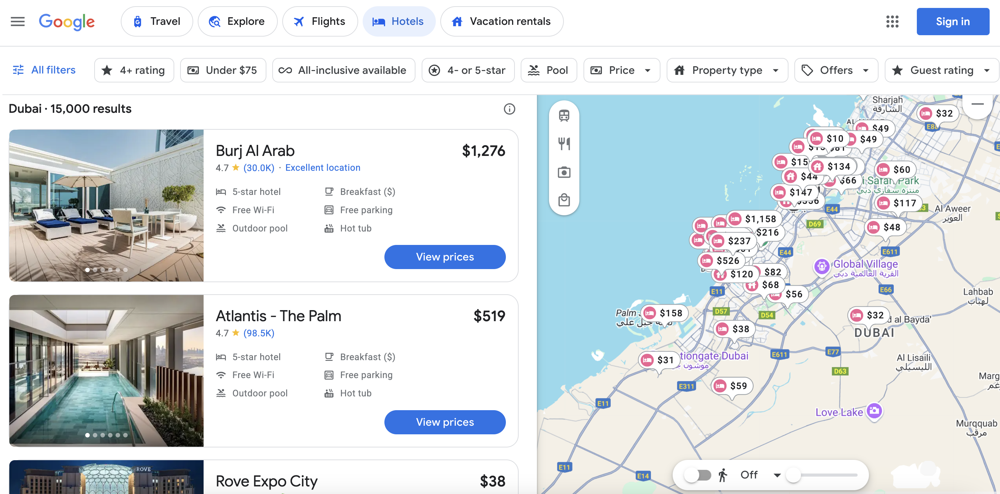
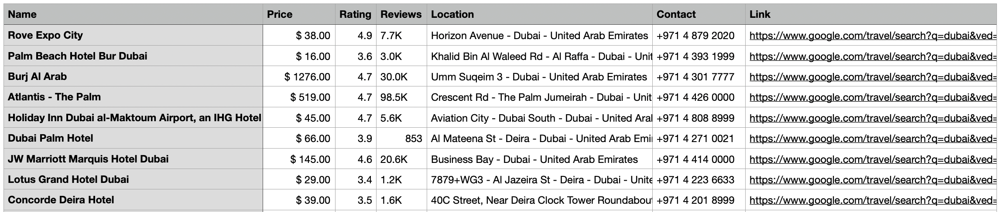
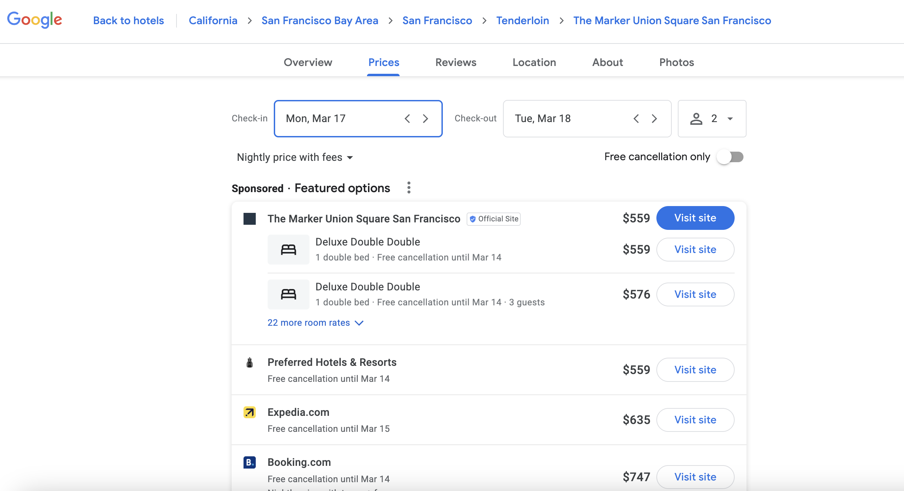
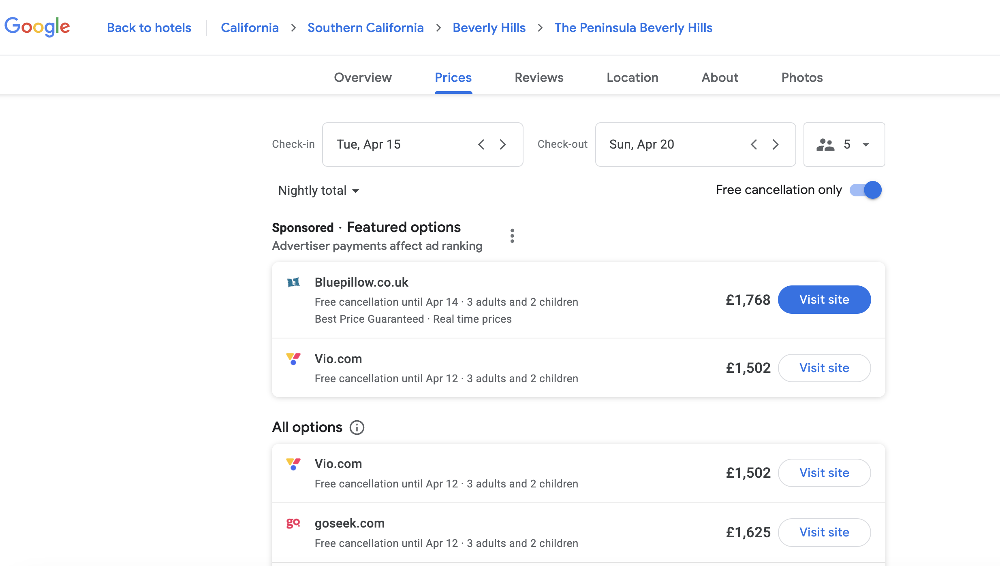

# Google Hotels 抓取工具

[](https://www.bright.cn/products/web-scraper/google-hotels)

了解如何从全球最大的旅游数据聚合平台之一 Google 实时抓取酒店数据。我们将介绍两种方法：

1. **免费抓取工具**：非常适合小规模需求。
2. **Bright Data Google Hotels API**：企业级解决方案，只需一次 API 调用，即可大规模采集 Google Hotels 公开数据（属于[搜索引擎爬虫 API](https://www.bright.cn/products/serp-api)的一部分）。


## 目录
- [免费抓取工具](#免费抓取工具)
  - [设置](#设置)
  - [使用方法](#使用方法)
  - [输出示例](#输出示例)
  - [限制](#限制)
- [Bright Data Google Hotels API](#bright-data-google-hotels-api)
  - [主要功能](#主要功能)
  - [前提条件](#前提条件)
  - [直接 API 访问](#直接-api-访问)
  - [原生代理访问](#原生代理访问)
- [高级功能](#高级功能)
  - [本地化参数](#本地化参数)
  - [预订参数](#预订参数)
  - [设备类型参数](#设备类型参数)
  - [响应格式](#响应格式)
- [替代解决方案](#替代解决方案)
- [支持与资源](#支持与资源)

## 免费抓取工具

一款简单快捷的爬虫工具，适用于小规模提取 Google Hotels 数据。



### 设置

**要求：**

- [Python 3.9+](https://www.python.org/downloads/)
- 用于浏览器自动化的 [Selenium](https://pypi.org/project/selenium/)
- 用于解析 HTML 的 [BeautifulSoup](https://pypi.org/project/beautifulsoup4/)
- 其他辅助库，例如 `pandas`、`tqdm`、`webdriver-manager`

**安装：**

```bash
pip install pandas tqdm selenium beautifulsoup4 webdriver-manager
```

**注意**：如果你刚开始接触网页爬虫，建议先阅读我们的 [Python 网页爬虫新手教程](https://www.bright.cn/blog/how-tos/web-scraping-with-python)或[使用 Selenium 进行网页爬虫的指南](https://www.bright.cn/blog/how-tos/using-selenium-for-web-scraping)。

### **使用方法**
使用必需参数运行 [google-hotels-scraper.py](https://github.com/bright-cn/google-hotels-api/blob/main/google-hotels-scraper/google-hotels-scraper.py) 脚本：
```bash
python3 google-hotels-scraper.py --location "Dubai" --max_hotels 200
```
_参数：_
- `location`：酒店数据的目标位置
- `max_hotels`：要抓取的酒店数量

💡 **专业提示：** 注释掉脚本中的 `options.add_argument("--headless=new")` 行，可降低被 Google 反爬虫系统检测到的概率。

### 输出示例



### 限制

免费抓取工具存在以下限制：

- IP 被封禁的风险较高
- 请求量有限
- 频繁出现 CAPTCHA
- 大规模抓取时可靠性不足

如需更大规模、更可靠地采集数据，请考虑下方的 Bright Data 专用解决方案 👇


## Bright Data Google Hotels API
[Bright Data 的 Google Hotels API](https://www.bright.cn/products/web-scraper/google-hotels) 是[搜索引擎爬虫 API](https://www.bright.cn/products/serp-api) 的一部分，并使用我们先进的[代理网络](https://www.bright.cn/proxy-types)。它可以帮助你大规模采集 Google Hotels 公开数据，而无需担心 CAPTCHA 或 IP 封禁。

### 主要功能
- **精准的全球定位**：针对特定位置定制结果
- **按成功请求付费模式**：仅为成功的请求付费
- **实时数据**：数秒内获取最新的酒店信息
- **可扩展性**：处理无限量请求，不受请求量限制
- **成本效益**：节省基础设施和维护成本
- **高可靠性**：内置反封锁措施，确保性能稳定
- **全天候支持**：随时获取专家帮助


### 前提条件

1. 创建 [Bright Data 账户](https://www.bright.cn/)（新用户可获得 5 美元额度）
2. 生成你的 [API 密钥](https://docs.brightdata.com/general/account/api-token)
3. 按照我们的[分步指南](https://github.com/bright-cn/google-hotels-api/blob/main/setup-serp-api-guide.md)配置搜索引擎 API 和访问凭据
4. 要使用 Google Hotels API，你需要所查询酒店的实体 ID。可通过以下步骤找到该 ID：
	1. 在 Google 中搜索酒店名称
	2. 右键单击并选择“查看网页源代码”
	3. 在页面中搜索“/entity”以查找实体 ID

### 直接 API 访问

直接向 API 端点发送请求。

**cURL 示例：**

```bash
curl https://api.brightdata.com/request \
  -H "Content-Type: application/json" \
  -H "Authorization: Bearer API_TOKEN" \
  -d '{
        "zone": "ZONE_NAME",
        "url": "https://www.google.com/travel/hotels/entity/CgoIyNaqqL33x5ovEAE/prices?brd_json=1",
        "format": "raw"
      }'
```

**Python 示例：**

```python
import requests
import json

url = "https://api.brightdata.com/request"
headers = {"Content-Type": "application/json", "Authorization": "Bearer API_TOKEN"}

payload = {
    "zone": "ZONE_NAME",
    "url": "https://www.google.com/travel/hotels/entity/CgoIyNaqqL33x5ovEAE/prices?brd_json=1",
    "format": "raw",
}

response = requests.post(url, headers=headers, json=payload)

with open("serp-direct-api.json", "w") as file:
    json.dump(response.json(), file, indent=4)

print("Response saved to 'serp-direct-api.json'.")
```

👉 查看[完整的 JSON 输出](https://github.com/bright-cn/google-hotels-api/blob/main/google-hotels-api-results/serp-direct-api.json)。

**注意：** 使用 `brd_json=1` 获取已解析的 JSON，或使用 `brd_json=html` 获取已解析的 JSON 和完整的嵌套 HTML。

### 原生代理访问

你也可以使用 Bright Data 的代理路由方法：

**cURL 示例：**

```bash
curl -i \
  --proxy brd.superproxy.io:33335 \
  --proxy-user "brd-customer-<customer-id>-zone-<zone-name>:<zone-password>" \
  -k \
  "https://www.google.com/travel/hotels/entity/CgoIyNaqqL33x5ovEAE/prices?brd_json=html"
```

**Python 示例：**

```python
import requests
import urllib3

urllib3.disable_warnings(urllib3.exceptions.InsecureRequestWarning)

host = "brd.superproxy.io"
port = 33335
username = "brd-customer-<customer-id>-zone-<zone-name>"
password = "<zone-password>"
proxy_url = f"http://{username}:{password}@{host}:{port}"

proxies = {"http": proxy_url, "https": proxy_url}
url = "https://www.google.com/travel/hotels/entity/CgoIyNaqqL33x5ovEAE/prices?brd_json=html"
response = requests.get(url, proxies=proxies, verify=False)

with open("serp-native-proxy.html", "w", encoding="utf-8") as file:
    file.write(response.text)

print("Response saved to 'serp-native-proxy.html'.")
```

👉 查看[完整的 JSON 输出](https://github.com/bright-cn/google-hotels-api/blob/main/google-hotels-api-results/serp-native-proxy.html)。

**注意：** 对于生产环境，请按照 [SSL 证书指南](https://docs.brightdata.com/general/account/ssl-certificate)中的说明加载 Bright Data 的 SSL 证书。

## 高级功能

Bright Data API 支持多种高级参数，可用于精细调整 Google Hotels 数据提取。以下示例使用**原生代理访问**，但你也可以通过直接 API 访问应用这些参数。

### 本地化参数




这些参数用于定义搜索的国家/地区和语言：

| 参数 | 说明 | 示例 |
| --- | --- | --- |
| gl | 两位国家/地区代码 | `gl=us`（美国） |
| hl | 两位语言代码 | `hl=en`（英语） |

**示例：** 搜索美国的酒店，并以英语显示结果：

```bash
curl --proxy brd.superproxy.io:33335 --proxy-user brd-customer-<customer-id>-zone-<zone-name>:<zone-password> \
"https://www.google.com/travel/hotels/entity/CgoI4NzJmsPmkpU6EAE/prices?gl=us&hl=en"
```

### 预订参数



这些参数可根据日期、住客人数、免费取消和住宿类型进一步筛选结果：

| 参数 | 说明 | 格式 | 示例 |
|-----------|-------------|--------|---------|
| brd_dates | 入住和退房日期 | YYYY-MM-DD,YYYY-MM-DD | `brd_dates=2025-08-15,2025-08-20` |
| brd_occupancy | 住客人数（成人 + 儿童） | `<adults>,<child1_age>,<child2_age>` | `brd_occupancy=3,6,9`（3 名成人、2 名年龄分别为 6 岁和 9 岁的儿童） |
| brd_free_cancellation | 仅显示可退款的预订 | true 或 false | `brd_free_cancellation=true` |
| brd_accomodation_type | 住宿类型 | hotels 或 vacation_rentals | `brd_accomodation_type=vacation_rentals` |
| brd_currency | 显示价格所用的货币 | 3 位货币代码 | `brd_currency=GBP`（英镑） |


**示例：** 使用特定参数搜索酒店住宿：
```bash
curl --proxy brd.superproxy.io:33335 \
  --proxy-user brd-customer-<customer-id>-zone-<zone-name>:<zone-password> \
  "https://www.google.com/travel/hotels/entity/CgoIyNaqqL33x5ovEAE/prices\
?brd_dates=2025-04-15,2025-04-20\
&brd_occupancy=3,6,9\
&brd_free_cancellation=true\
&brd_currency=GBP"
```


### 设备类型参数
默认情况下，请求会模拟桌面端 User-Agent，但你可以将其更改为移动端：

| 参数 | 说明 | 
|-----------|-------------|
| `brd_mobile=0` | 随机桌面端 User-Agent（默认） | 
| `brd_mobile=1` | 随机移动端 User-Agent |
| `brd_mobile=ios` | iPhone User-Agent |
| `brd_mobile=android` | Android 手机 User-Agent |
| `brd_mobile=ipad` | iPad User-Agent |
| `brd_mobile=android_tablet` | Android 平板电脑 User-Agent |

**示例：** 使用 Android 手机 User-Agent 获取酒店数据：

```bash
curl --proxy brd.superproxy.io:33335 --proxy-user brd-customer-<customer-id>-zone-<zone-name>:<zone-password> \
"https://www.google.com/travel/hotels/entity/CgoIyNaqqL33x5ovEAE/prices?brd_mobile=android"
```

### 响应格式
默认情况下，响应采用 HTML 格式，但你也可以请求 JSON 响应：

| 参数 | 说明 |
|-----------|-------------|
| `brd_json=1` | 返回 JSON 响应而非 HTML |
| `brd_json=html`	| JSON + 完整的嵌套 HTML |

**示例：** 获取 JSON 格式的酒店价格数据：

```bash
curl --proxy brd.superproxy.io:33335 --proxy-user brd-customer-<customer-id>-zone-<zone-name>:<zone-password> \
"https://www.google.com/travel/hotels/entity/CgoIyNaqqL33x5ovEAE/prices?brd_json=1"
```

## 替代解决方案

除了[网页爬虫工具 API](https://www.bright.cn/products/web-scraper)，Bright Data 还提供专为旅游行业需求定制的即用型[数据集](https://www.bright.cn/products/datasets)：

- [酒店数据集](https://www.bright.cn/products/datasets/travel/hotels)
- [Airbnb 数据集](https://www.bright.cn/products/datasets/airbnb)
- [Expedia 数据集](https://www.bright.cn/products/datasets/travel/expedia)
- [旅游业数据集](https://www.bright.cn/products/datasets/tourism)
- [Booking.com 数据集](https://www.bright.cn/products/datasets/booking)
- [TripAdvisor 数据集](https://www.bright.cn/products/datasets/tripadvisor)


## 支持与资源

- **文档**：[搜索引擎 API 文档](https://docs.brightdata.com/scraping-automation/serp-api/)
- **探索相关指南**： 
  - [网络解锁器 API](https://github.com/bright-cn/web-unlocker-api)
  - [搜索引擎 API](https://github.com/bright-cn/serp-api)
  - [Google 搜索 API](https://github.com/bright-cn/google-search-api)
  - [Google 新闻抓取工具](https://github.com/bright-cn/Google-News-Scraper)
  - [Google Trends API](https://github.com/bright-cn/google-trends-api)
  - [Google 评论 API](https://github.com/bright-cn/google-reviews-api)
- **实用文章**：
  - [最佳搜索引擎 API](https://www.bright.cn/blog/web-data/best-serp-apis)
  - [使用搜索引擎 API 构建 RAG 聊天机器人](https://www.bright.cn/blog/web-data/build-a-rag-chatbot)
- **使用场景**：
	- [SEO 应用](https://www.bright.cn/use-cases/serp-tracking)
	- [旅游行业应用](https://www.bright.cn/use-cases/travel)
- **联系方式**：需要帮助？请发送电子邮件至 support@brightdata.com
